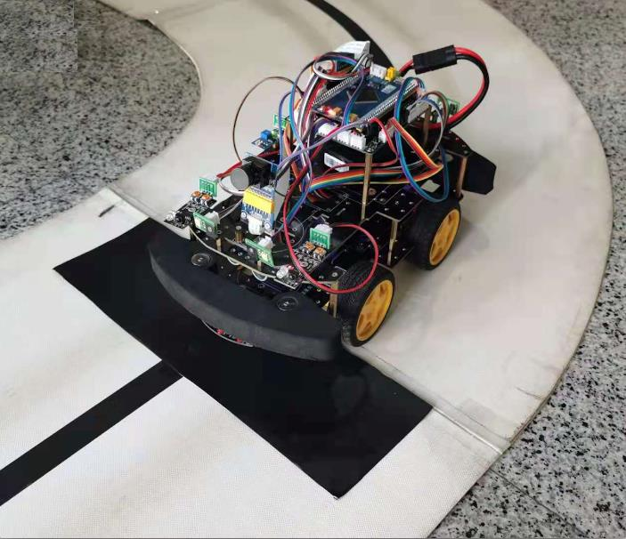
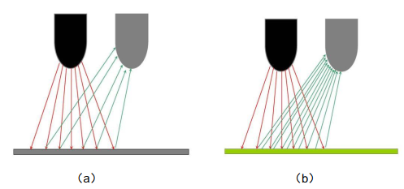
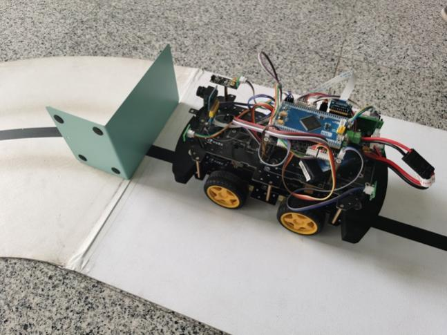
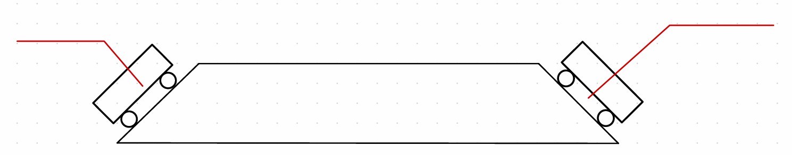
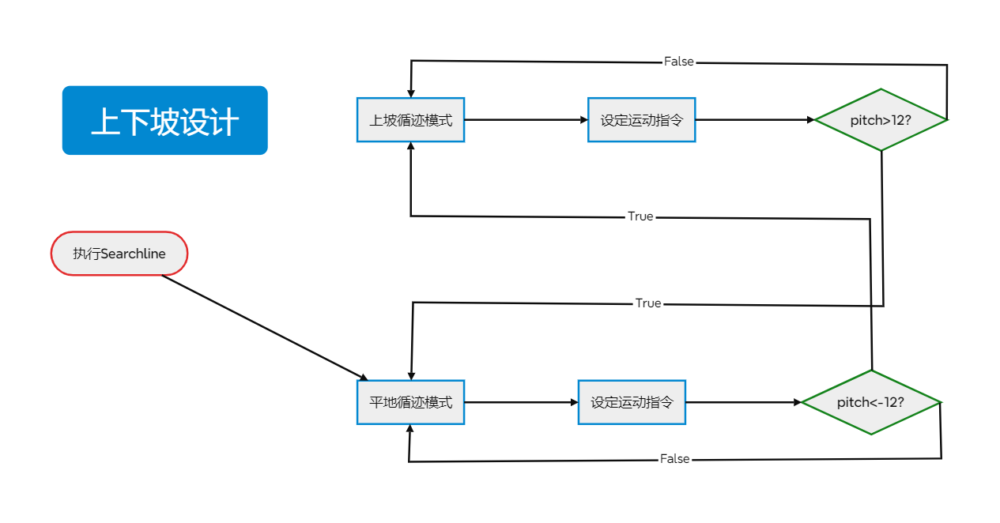
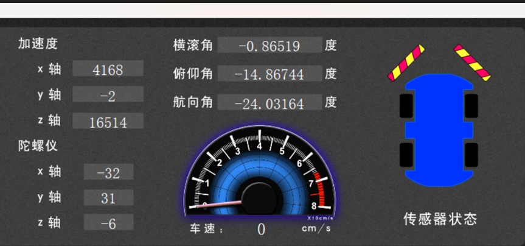
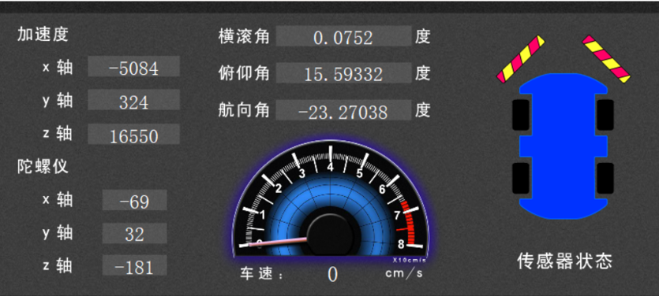
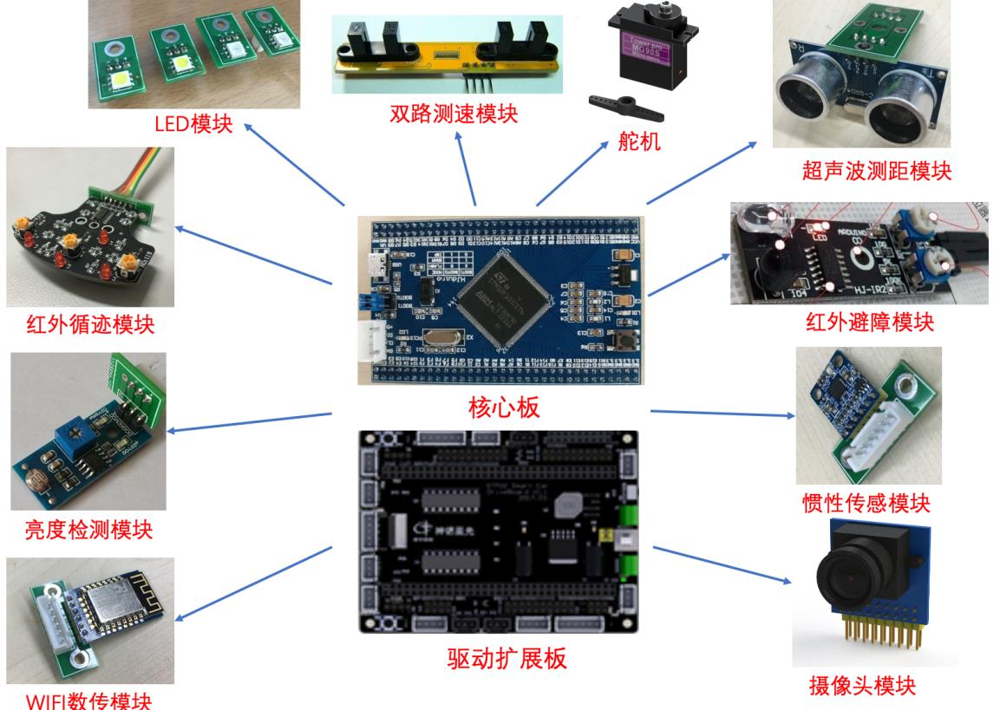
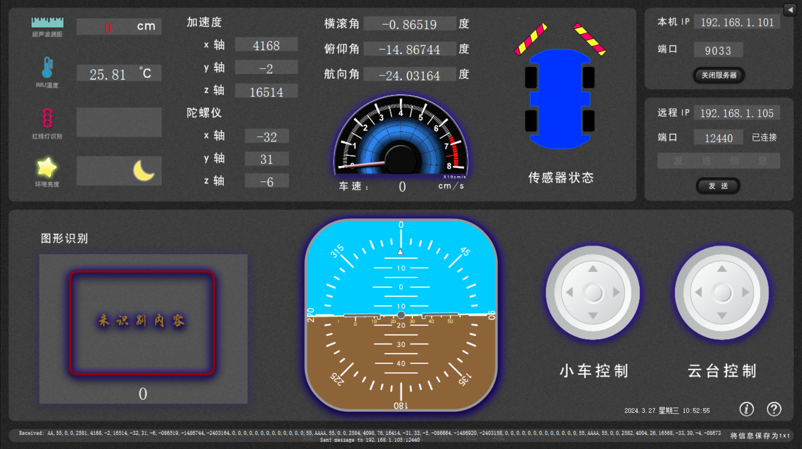

# 仪光智能小车 · STM32 Smart Car

[中文](#zh-cn) | [English](#en)

<p align="center">
  
</p>
<p align="center"><em>三路红外循迹 · 障碍减速停车 · 坡道状态切换<br>Infrared line tracking · Obstacle stopping · Ramp traversal</em></p>

<a id="zh-cn"></a>

## 中文

[Switch to English ↓](#en)

基于 **STM32F103ZE** 的四轮智能小车项目，使用三路红外传感器循迹，结合超声波、红外避障和 MPU6050 姿态数据，实现平地巡线、障碍减速停车与坡道通行。固件采用 C 语言和 STM32 标准外设库，工程使用 Keil µVision；随附基于 Adobe AIR 的桌面上位机。

### 功能与实现

| 功能 | 当前实现 |
| --- | --- |
| 三路循迹 | 读取左、中、右红外信号，通过左右轮差速修正方向；全部丢线时参考上一次运动状态 |
| 障碍减速停车 | 平地模式下，超声波读数小于 40 cm 且大于 0 时低速前进；小于 13 cm 且大于 0，或任一避障红外输出低电平时停车 |
| 坡道状态切换 | `pitch < -12°` 时进入坡道模式，`pitch > +12°` 时切回平地模式，符号取决于传感器安装方向 |
| 黑区处理 | 三路同时检测到黑色时，平地模式停车，坡道模式继续直行 |
| 四轮驱动 | TIM2 中断执行软件 PWM，支持前进、后退、差速转向、减速与停车 |
| Wi-Fi 数据上传 | ESP8266 以 STA / TCP 客户端方式连接上位机，发送逗号分隔的状态帧 |

现有场地测试记录：停车距离约 **4.7 cm**，单圈用时约 **12.17 s**。这些数据对应原车与原赛道，传感器阈值需要按实际装配和场地重新标定；代码中的 13 cm 是触发读数，不代表最终车体停车间距。

### 控制逻辑

`main.c` 中的 `SearchLine()` 负责传感器判断和指令选择，`Move()` 将指令交给电机驱动；`stm32f10x_it.c` 中的 TIM2 中断负责实际电机输出和舵机脉冲。

平地模式先判断三路全黑停车，再处理障碍停车和减速，随后读取姿态并进行循迹。坡道模式读取姿态并执行循迹，三路全黑时继续直行；**该分支不执行平地模式的超声波与红外障碍停车判断**。

#### 三路红外循迹

<p align="center">
  
</p>

黑色与浅色表面对红外光的反射不同。小车读取左、中、右三个位置的检测结果，再通过左右轮速度差修正行进方向；三个传感器均离开黑线时，参考上一循环的运动状态。

#### 障碍减速与停车



平地模式下，以超声波读数进行提前减速，并结合左右红外传感器判断近距离障碍。图中为挡板与小车的实际布置；停车触发阈值和最终车体间距需要分别标定。

#### 坡道通行与模式切换



同样的“三路全黑”信号，在平地终点与坡道转折处需要作出不同响应。因此程序使用平地、坡道两种状态，并通过俯仰角阈值切换，减少坡道上误停车的情况。



| 上坡采集画面 | 下坡采集画面 |
| --- | --- |
|  |  |

采集画面反映原车安装方向下的俯仰角符号；程序使用的切换阈值为 `-12°` 和 `+12°`，并非直接采用截图中的瞬时读数。

### 目录结构

```text
.
├── newest/
│   ├── USER/                 # main.c、中断、启动文件与 SmartCar.uvprojx
│   ├── HARDWARE/             # 电机、传感器、显示、Wi-Fi 等驱动
│   │   ├── INTERFACE/        # 引脚映射、运动指令与默认占空比
│   │   ├── MOTOR/            # 四轮驱动与运动控制
│   │   ├── Ultrasonic/       # 超声波测距
│   │   ├── MPU6050/          # IMU、软件 I²C 与 DMP 驱动
│   │   └── ESP8266/          # AT 命令、联网配置与数据收发
│   ├── SYSTEM/               # 时钟相关辅助、延时和串口
│   ├── CMSIS/                # Cortex-M3 内核与 STM32 系统文件
│   ├── StdPeriph_Driver/     # STM32 标准外设库
│   ├── MALLOC/               # 内存管理
│   └── USMART/               # 串口调试组件
├── docs/images/              # README 使用的实物图、原理图与界面截图
├── 上位机程序/               # car1.33.app 与通信格式说明
├── *.png                     # 设计示意图与采集截图
└── dist.mat                  # MATLAB 数据文件
```

### 硬件与主要接口



硬件平台的模块总览如上图所示；各模块在当前程序中的启用情况见文末说明。

| 模块 | 当前代码对应的接口 |
| --- | --- |
| 主控 | STM32F103ZE，Cortex-M3，系统时钟配置为 72 MHz |
| 左 / 中 / 右循迹 | PG4 / PG6 / PG8；黑色为 1，白色为 0 |
| 左 / 右红外避障 | PG2 / PE10；低电平表示检测到障碍 |
| 超声波 | Trig：PD8；Echo：PB14 |
| MPU6050 | 软件 I²C：PB6（SCL）、PB7（SDA） |
| 左前 / 右前电机 | PD13、PD11 / PE13、PE15 |
| 左后 / 右后电机 | PD9、PD10 / PE14、PE12 |
| ESP8266 | USART3：PB10（TX）、PB11（RX），115200 baud |
| 调试串口 | USART1，115200 baud |

详细定义见 [`interface.h`](newest/HARDWARE/INTERFACE/interface.h)。超声波 Trig 宏按原板电平转换电路进行了反相处理，迁移接线时应核对驱动宏与实际电平。

### 构建与运行

1. 准备 Keil MDK / µVision。工程记录的编译器为 **ARM Compiler 5.06 update 4（build 422）**，器件包为 **Keil.STM32F1xx_DFP 2.4.1**；优先使用匹配环境。
2. 打开 [`newest/USER/SmartCar.uvprojx`](newest/USER/SmartCar.uvprojx)，选择 `demo` 目标。工程预定义为 `USE_STDPERIPH_DRIVER` 和 `STM32F10X_HD`。
3. 检查 Include Paths。现有配置包含 `C:\Keil_v5\ARM\ARMCC\include` 绝对路径，以及当前目录中不存在的 `HARDWARE/EasyTracer` 路径；按本机安装位置调整或清理无效项。
4. 在 [`common.c`](newest/HARDWARE/ESP8266/common.c) 中设置 `wifista_ssid`、`wifista_password`、`wifista_ip` 和 `portnum`。其中 `wifista_ip` 是上位机 TCP 服务器地址，现有端口为 `9033`。
5. 编译工程。配置的固件输出为 `newest/USER/Objects/htdemo.hex`，通过与实物匹配的下载器烧录。
6. 在 Windows 下启动 `上位机程序/car1.33.app/car1.33.exe`，保留同目录的 Adobe AIR 运行时及其他资源，并使 TCP 服务监听与固件配置一致的端口。
7. 完成接线、网络和传感器检查后，上电测试循迹、减速停车及坡道切换。

若仅调试离线循迹，可在 `main.c` 中暂时停用 `atk_8266_wifista_Init()`。当前初始化包含等待模块响应和接入网络的循环，模块缺失或配置不匹配时，主循环可能无法开始。

### 数据通信



上位机可展示距离、姿态与传感器状态，右侧为网络连接与控制区域。画面中包含平台的完整界面，实际可用功能取决于当前固件启用的采集与控制逻辑。

`atk_8266_wifista_Tran()` 在主循环中定期发送 ASCII 数据，格式为：

```text
AA,55,distance,speed,temp,ax,ay,az,gx,gy,gz,roll,pitch,yaw,bright,ir_left,ir_right,line_left,line_mid,line_right,red,green,id,light_lf,light_rf,light_lb,light_rb,55,AA
```

`roll`、`pitch`、`yaw` 发送前乘以 `100000`。字段顺序和格式以 [`wifista.c`](newest/HARDWARE/ESP8266/wifista.c) 为准，协议说明位于 `上位机程序/上位机数据格式.xlsx`。部分采集或识别功能在当前主循环中未启用，因此上传字段不一定全部实时更新。

### 调参与当前边界

- 距离和姿态阈值位于 [`main.c`](newest/USER/main.c) 的 `SearchLine()`；默认占空比 `SPEED_DUTY = 50` 位于 `interface.h`，转向和减速比例位于 [`motor.c`](newest/HARDWARE/MOTOR/motor.c)。
- 当前按 5 ms 计数条件调度主循环，但延时、采集与网络操作会影响实际执行间隔。
- `KEY1` / `KEY2` 会切换 `Is_Display` / `Is_Movebyline`，当前主循环仍直接调用 `SearchLine()`，`KEY2` 尚未作为循迹启停门控。
- 仓库包含红外遥控、摄像头、测速、环境亮度和显示相关代码；当前 `SignalReceive()`、`MeasureSpeed()`、`BrightCheck()`、摄像头初始化及 `OLED_Init()` 未启用，显示写入调用仍有保留。使用这些功能前需检查初始化与调用链。
- 工程包含第三方库和桌面运行组件，使用和分发时应遵循各组件自带的许可说明。

[English ↓](#en) · [返回中文顶部 ↑](#zh-cn)

---

<a id="en"></a>

## English

[切换到中文 ↑](#zh-cn)

A four-wheel smart car built around the **STM32F103ZE**. Three infrared sensors provide line tracking, while ultrasonic ranging, infrared obstacle sensors and MPU6050 orientation data support obstacle slowdown, stopping and ramp traversal. The firmware uses C, the STM32 Standard Peripheral Library and Keil µVision. An Adobe AIR desktop application is included.

### Features and implementation

| Feature | Current implementation |
| --- | --- |
| Three-sensor line tracking | Corrects direction through differential wheel speeds; uses the previous movement state when all sensors lose the line |
| Obstacle slowdown and stopping | In flat-ground mode, moves slowly for a positive ultrasonic reading below 40 cm; stops below 13 cm or when either obstacle sensor goes low |
| Ramp state switching | Enters ramp mode at `pitch < -12°` and returns to flat-ground mode at `pitch > +12°`; signs depend on IMU mounting |
| All-black detection | Stops on flat ground and continues straight in ramp mode |
| Four-wheel drive | TIM2 interrupt-driven software PWM for forward, reverse, turns, slowdown and stopping |
| Wi-Fi telemetry | ESP8266 operates as a STA / TCP client and sends comma-separated status frames |

Existing track measurements recorded approximately **4.7 cm** stopping clearance and a **12.17 s** lap. These values apply to the original vehicle and track. Recalibrate thresholds for the actual assembly and surface; the 13 cm trigger reading is not the final physical stopping clearance.

### Control flow

`SearchLine()` in `main.c` selects movement commands; `Move()` passes them to the motor driver. The TIM2 interrupt in `stm32f10x_it.c` generates motor outputs and servo pulses.

Flat-ground mode checks the all-black stop condition, obstacle stopping and slowdown before reading orientation and tracking the line. Ramp mode reads orientation and tracks the line, continuing straight over an all-black region. **The ramp branch does not run the flat-ground ultrasonic / infrared obstacle-stop checks.**

#### Infrared line tracking

<p align="center">
  
</p>

Dark and light surfaces reflect infrared light differently. Readings from the left, middle and right sensors guide differential wheel-speed corrections. When all three sensors lose the line, the controller refers to its previous movement state.

#### Obstacle slowdown and stopping


In flat-ground mode, ultrasonic readings trigger early slowdown, while the left and right infrared sensors provide additional nearby-obstacle detection. The photo shows the physical barrier setup; calibrate the trigger reading separately from the final vehicle-to-barrier clearance.

#### Ramp traversal and state switching


An all-black reading requires different responses at a flat-ground finish marker and a ramp transition. Separate flat-ground and ramp states, selected using pitch thresholds, help avoid unintended stops on the ramp.


| Uphill capture | Downhill capture |
| --- | --- |
|  |  |

These captures show the pitch signs for the original IMU mounting. The switching thresholds in the code are `-12°` and `+12°`, rather than the instantaneous values shown in the images. The diagrams retain their original Chinese labels; the surrounding text explains the behavior in English.

### Project layout

| Path | Purpose |
| --- | --- |
| `newest/USER/` | Main loop, interrupt handlers, startup code and `SmartCar.uvprojx` |
| `newest/HARDWARE/` | Motors, sensors, display, camera, Wi-Fi and interface definitions |
| `newest/SYSTEM/` | System helpers, delays and UART drivers |
| `newest/CMSIS/` | Cortex-M3 core and STM32 system files |
| `newest/StdPeriph_Driver/` | STM32 Standard Peripheral Library |
| `newest/MALLOC/`, `newest/USMART/` | Memory management and serial debugging components |
| `docs/images/` | README photos, diagrams and interface captures |
| `上位机程序/` | Desktop application and communication format reference |
| Root-level PNG files, `dist.mat` | Design diagrams, captured images and MATLAB data |

### Hardware and main interfaces


The image above shows the platform's hardware modules. See the limitations below for which modules the current firmware enables.

| Module | Interface used by the current code |
| --- | --- |
| MCU | STM32F103ZE, Cortex-M3, configured for a 72 MHz system clock |
| Left / middle / right line sensors | PG4 / PG6 / PG8; black = 1, white = 0 |
| Left / right obstacle sensors | PG2 / PE10; obstacle detection is active low |
| Ultrasonic sensor | Trig: PD8; Echo: PB14 |
| MPU6050 | Software I²C: PB6 (SCL), PB7 (SDA) |
| Front-left / front-right motors | PD13, PD11 / PE13, PE15 |
| Rear-left / rear-right motors | PD9, PD10 / PE14, PE12 |
| ESP8266 | USART3: PB10 (TX), PB11 (RX), 115200 baud |
| Debug serial | USART1, 115200 baud |

See [`interface.h`](newest/HARDWARE/INTERFACE/interface.h) for the full mapping. The ultrasonic Trig macros account for an inverting level-conversion circuit on the original board; verify signal polarity when changing hardware.

### Build and run

1. Prepare Keil MDK / µVision. The project records **ARM Compiler 5.06 update 4 (build 422)** and **Keil.STM32F1xx_DFP 2.4.1**; start with a matching environment.
2. Open [`newest/USER/SmartCar.uvprojx`](newest/USER/SmartCar.uvprojx) and select target `demo`. The project defines `USE_STDPERIPH_DRIVER` and `STM32F10X_HD`.
3. Check Include Paths. The configuration contains the absolute path `C:\Keil_v5\ARM\ARMCC\include` and an entry for `HARDWARE/EasyTracer`, which is absent from this tree. Adjust local paths and remove obsolete entries as needed.
4. Set `wifista_ssid`, `wifista_password`, `wifista_ip` and `portnum` in [`common.c`](newest/HARDWARE/ESP8266/common.c). `wifista_ip` is the desktop TCP server address; the existing port is `9033`.
5. Build the project and flash the configured output, `newest/USER/Objects/htdemo.hex`, using a programmer compatible with the board.
6. On Windows, launch `上位机程序/car1.33.app/car1.33.exe`. Keep its Adobe AIR runtime and companion resources together, and configure the TCP service to listen on the firmware's selected port.
7. Check wiring, networking and sensor readings, then power up and test tracking, obstacle stopping and ramp transitions.

For offline line-tracking work, temporarily disable `atk_8266_wifista_Init()` in `main.c`. Its startup loops wait for module responses and network association, so a missing module or incorrect settings can prevent entry into the main loop.

### Telemetry


The desktop interface displays distance, orientation and sensor status, with networking and control areas on the right. The capture shows the full platform interface; available features depend on the acquisition and control routines enabled in the firmware.

`atk_8266_wifista_Tran()` periodically sends ASCII frames from the main loop:

```text
AA,55,distance,speed,temp,ax,ay,az,gx,gy,gz,roll,pitch,yaw,bright,ir_left,ir_right,line_left,line_mid,line_right,red,green,id,light_lf,light_rf,light_lb,light_rb,55,AA
```

Angles are multiplied by `100000` before transmission. See [`wifista.c`](newest/HARDWARE/ESP8266/wifista.c) for the field order and formatting, and `上位机程序/上位机数据格式.xlsx` for the protocol reference. Some acquisition and recognition routines are disabled in the current main loop, so not all transmitted fields necessarily contain live readings.

### Tuning and current limitations

- Distance and orientation thresholds are in `SearchLine()` in [`main.c`](newest/USER/main.c). The default `SPEED_DUTY = 50` is in `interface.h`; turn and slowdown ratios are in [`motor.c`](newest/HARDWARE/MOTOR/motor.c).
- The main loop uses a 5 ms scheduling condition; delays, sensor reads and network operations affect its actual execution interval.
- `KEY1` / `KEY2` toggle `Is_Display` / `Is_Movebyline`. The loop still calls `SearchLine()` directly, so `KEY2` currently does not gate line tracking.
- Infrared remote control, camera, speed measurement, ambient-light and display code is included. `SignalReceive()`, `MeasureSpeed()`, `BrightCheck()`, camera initialization and `OLED_Init()` are disabled in the current program, while some display writes remain. Check initialization and call paths before enabling those features.
- Third-party libraries and desktop runtime components retain their own license terms. Follow the notices supplied with those components when using or redistributing them.

[中文 ↑](#zh-cn) · [Back to English ↑](#en)
